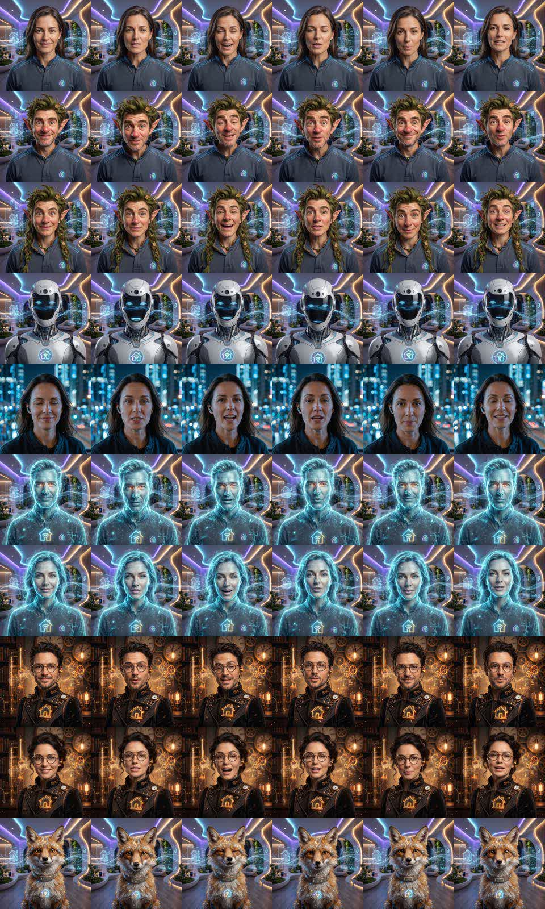

# Balss palīga avatars Home Assistant Assist

**[English →](README.md)**

Runājoša seja tavam Home Assistant balss palīgam. Avatārs gaida, klausās, domā un runā, un viņa lūpas kustas video cilpās. Kad palīgs ir aktīvs, seja izplešas pāri panelim un zem tās redzams, ko tu teici un ko viņš atbildēja.


- **Strādā ar jebkuru balss satelītu** (VACA, ESPHome, Home Assistant Voice PE …) vai **bez tā**. Datorā, telefonā vai planšetē kartīte var klausīties caur pašas ierīces mikrofonu un atbildēt caur tās skaļruni.
- **Divpadsmit gatavi avatāri:** Niko, Lina, Viktors, Ieva, Orions, Aura, Teodors, Ada, Čiekurs, Sūna, Rudis un Volts, katram ir "gaida" un "runā" video cilpa. Izvēle ar ilgu spiedienu uz sejas.
- **Latviešu un angļu valoda**, ko kartīte izvēlas automātiski pēc HA valodas.
- **Vizuālais redaktors**, YAML nav vajadzīgs.
- **Var novietot virs jebkura elementa**, piemēram, virs mikrofona ikonas [ha-floorplan](https://github.com/ExperienceLovelace/ha-floorplan) SVG.



## Uzstādīšana

### HACS (pielāgota krātuve)

1. Atver **HACS → ⋮ → Custom repositories**.
2. Pievieno šīs krātuves URL ar tipu **Dashboard**.
3. Atrodi **Avatar Card**, uzstādi to un pārlādē pārlūku.

### Ar roku

1. Nokopē visu no `dist/` uz `/config/www/avatar-card/`.
2. Pievieno paneļa resursu `/local/avatar-card/avatar-card.js` ar tipu **JavaScript modulis**.

## Lietošana

Pievieno kartīti un meklē **Balss palīga avatars**. Jauna kartīte pati atrod pirmo `assist_satellite` un aizpilda atbilstošās VACA entītijas, ja tās ir. Visi iestatījumi ir vizuālajā redaktorā.

| Darbība | Kas notiek |
|---|---|
| Pieskāriens sejai | Sāk sarunu. Vēlreiz pieskaroties, beidz klausīties vai pārtrauc atbildi. |
| Ilgs spiediens uz sejas | Atver palīga izvēli. Ja izmanto satelītu, tur ir arī mikrofona izslēgšana. |
| Pieskāriens tumšajam fonam | Paslēpj izplesto seju līdz nākamajai sarunai. |

### Kur klausīties (`voice`)

| Vērtība | Kā strādā |
|---|---|
| `auto` (noklusēts) | Android WebView kiosks (piemēram, VACA) ar norādītu satelītu modina satelītu. Viss pārējais, arī datora pārlūks un HA aplikācija, izmanto savu mikrofonu un skaļruni. Ja `entity` nav norādīts, vienmēr klausās pati ierīce. |
| `satellite` | Vienmēr modina satelītu ar `wake_button` vai `assist_satellite.start_conversation`. |
| `browser` | Vienmēr izmanto šīs ierīces mikrofonu un skaļruni caur `assist_pipeline/run`. |

Vienā ierīcē režīmu var piespiest, atverot paneli ar `?avatar_voice=browser`, `?avatar_voice=satellite` vai `?avatar_voice=auto`. Ierīce izvēli atceras.

> Mikrofons strādā tikai caur **https://**, jo pārlūki `getUserMedia` atļauj tikai drošā savienojumā.

### Iestatījumi

| Iestatījums | Noklusēts | Apraksts |
|---|---|---|
| `entity` | – | `assist_satellite.*`, kura stāvoklis vada seju. Ja nav norādīts, atbild pati ierīce. |
| `avatars` | visi 12 | Avatāru id saraksts vai objekti `{id, name, image, videos}`. Iebūvēto avatāru id ir zemāk sadaļā **Avatāri**. |
| `voice` | `auto` | `auto`, `satellite` vai `browser`. |
| `wake_button` | – | Poga, kas liek satelītam klausīties (VACA: `button.vaca_*_wake`). |
| `mute_entity` | – | Satelīta mikrofona slēdzis. Tas ir redzams izvēlē, un, kad mikrofons izslēgts, seja ir pelēka. |
| `stt_entity` / `tts_entity` | – | Sensori ar pēdējo atpazīto tekstu un pēdējo atbildi (VACA ir abi). |
| `pipeline` | noklusētais | Balss palīgs, ko izmanto, kad atbild pati ierīce. |
| `select_entity` | – | `input_select`, kas dala izvēlēto avatāru starp visām ierīcēm. Bez tā katra ierīce atceras savu izvēli. |
| `size` | `110` | Sejas izmērs kartītē, px. |
| `expand` | `true` | Aktīvā stāvoklī izplest seju pāri ekrānam. |
| `anchor` | – | Elementa id, virs kura novietot seju (to meklē arī shadow DOM), piemēram, `sams.ring`. Tad pati kartīte vietu neaizņem. |
| `anchor_scale` | `1` | Sejas izmērs attiecībā pret šo elementu. |
| `avatar_base` | kartītes mape | Mape ar failiem `<id>.jpg`, `<id>_idle.mp4` un `<id>_talk.mp4`. |

Piemērs:

```yaml
type: custom:avatar-card
entity: assist_satellite.virtuve
avatars: [pilseta, robots, elfe]
voice: auto
```

## Avatāri

| id | Vārds | |
|---|---|---|
| `pilseta` | Niko | vīrietis, nakts pilsēta |
| `pilsetniece` | Lina | sieviete, nakts pilsēta |
| `virietis` | Viktors | vīrietis, gudrā māja |
| `sieviete` | Ieva | sieviete, gudrā māja |
| `holovirietis` | Orions | hologrammas vīrietis |
| `holosieviete` | Aura | hologrammas sieviete |
| `inzenieris` | Teodors | tvaikpanka inženieris |
| `inzeniere` | Ada | tvaikpanka inženiere |
| `elfs` | Čiekurs | meža elfs |
| `elfe` | Sūna | meža elfe |
| `lapsa` | Rudis | lapsa |
| `robots` | Volts | robots |

Vārdi ir latviski vai angliski pēc HA valodas. Savu vārdu var iestatīt ar `name` ierakstā `avatars`.

## Savi avatāri

Katram avatāram blakus kartītei (vai mapē `avatar_base`) ieliec trīs failus:

- `manid.jpg`: kvadrātisks portrets.
- `manid_idle.mp4`: dažas sekundes gara klusa cilpa.
- `manid_talk.mp4`: cilpa, kurā avatārs runā.

Tad pievieno `manid` sarakstam `avatars`. Seja strādā arī tikai ar bildi: tā viegli "elpo", un runājot ap to redzami skaņas viļņi.

Komplektā esošie klipi uzģenerēti lokāli no viena portreta ar [WanGP](https://github.com/deepbeepmeep/Wan2GP) InfiniteTalk un 4 soļu LightX2V LoRA (uz RTX 3060 12 GB aptuveni 10 minūtes klipam). Tam izmantotie skripti ir `tools/gen_all.py` un `tools/deploy.py`. Tie ir piemēri, tāpēc ceļus failu sākumā pielāgo sev.

## Licence

MIT
