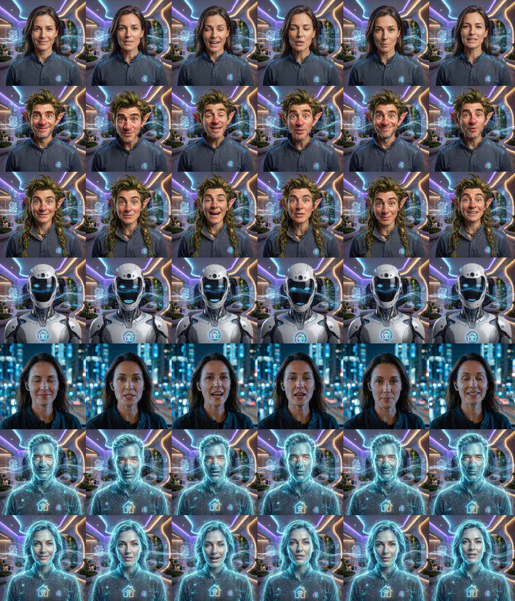

# Avatar Card for Home Assistant Assist

**[Latviski →](README.lv.md)**

A talking face for your Home Assistant voice assistant. The avatar idles, listens, thinks and speaks with lip-synced video loops. While Assist is active it expands over the dashboard and shows what you said and what it answered.


- **Works with any voice satellite** (VACA, ESPHome, Home Assistant Voice PE, …) or **without one**: on a PC, phone or tablet the card can listen with that device's own microphone and answer through its speaker.
- **Nine ready-made avatars:** Niko, Lina, Victor, Eva, Orion, Aura, Twig, Moss and Volt. Each has idle and talking video loops. Long-press the face to pick one.
- **English and Latvian**, chosen automatically from your Home Assistant language.
- **Visual editor:** no YAML needed.
- **Can sit on top of any element**, for example a microphone icon in an [ha-floorplan](https://github.com/ExperienceLovelace/ha-floorplan) SVG.



## Installation

### HACS (custom repository)

1. Open **HACS → ⋮ → Custom repositories**.
2. Add this repository's URL with type **Dashboard**.
3. Find **Avatar Card**, install it, and reload the browser.

### Manual

1. Copy everything from `dist/` to `/config/www/avatar-card/`.
2. Add a dashboard resource `/local/avatar-card/avatar-card.js` with type **JavaScript module**.

## Usage

Add a card and search for **Voice assistant avatar**. A new card finds your first `assist_satellite` and fills in the matching VACA entities if they exist. Every option is in the visual editor.

| How you use it | What happens |
|---|---|
| Tap the face | Start talking. Tap again to stop listening or interrupt the answer. |
| Long-press the face | Open the avatar picker. On a satellite it also has a mute button. |
| Tap the dark background | Hide the expanded face until the next conversation. |

### Where it listens (`voice`)

| Value | Behaviour |
|---|---|
| `auto` (default) | An Android WebView kiosk (for example VACA) that has a satellite configured wakes the satellite. Everything else, including a PC browser or the HA Companion app, uses its own microphone and speaker. Without `entity`, it always uses the device itself. |
| `satellite` | Always wake the satellite, using `wake_button` or `assist_satellite.start_conversation`. |
| `browser` | Always use this device's microphone and speaker through `assist_pipeline/run`. |

You can force a mode on one device by opening the dashboard with `?avatar_voice=browser`, `?avatar_voice=satellite` or `?avatar_voice=auto`. The device remembers the choice.

> The microphone only works over **https://**, which browsers require for `getUserMedia`.

### Options

| Option | Default | Description |
|---|---|---|
| `entity` | – | `assist_satellite.*` whose state drives the face. If omitted, the device answers itself. |
| `avatars` | all 9 | List of avatar ids, or objects `{id, name, image, videos}`. Built-in ids are listed under **Avatars** below. |
| `voice` | `auto` | `auto`, `satellite` or `browser`. |
| `wake_button` | – | Button that makes the satellite listen (VACA: `button.vaca_*_wake`). |
| `mute_entity` | – | Satellite mic mute switch. It is shown in the picker, and the face turns grey while muted. |
| `stt_entity` / `tts_entity` | – | Sensors with the last recognised text and the last answer (VACA has both). |
| `pipeline` | preferred | Assist pipeline used when the device itself answers. |
| `select_entity` | – | An `input_select` that shares the chosen avatar between all devices. Without it, each device remembers its own choice. |
| `size` | `110` | Face size in the card, in px. |
| `expand` | `true` | Expand the face over the screen while active. |
| `anchor` | – | Element id to sit on top of (searched through shadow DOM), for example `sams.ring`. The card itself then takes no space. |
| `anchor_scale` | `1` | Face size relative to the anchor element. |
| `avatar_base` | card folder | Folder with `<id>.jpg`, `<id>_idle.mp4` and `<id>_talk.mp4`. |

Example:

```yaml
type: custom:avatar-card
entity: assist_satellite.kitchen
avatars: [pilseta, robots, elfe]
voice: auto
```

## Avatars

| id | Name | |
|---|---|---|
| `pilseta` | Niko | man, night city |
| `pilsetniece` | Lina | woman, night city |
| `virietis` | Victor | man, smart home |
| `sieviete` | Eva | woman, smart home |
| `holovirietis` | Orion | hologram man |
| `holosieviete` | Aura | hologram woman |
| `elfs` | Twig | forest elf |
| `elfe` | Moss | forest elf girl |
| `robots` | Volt | robot |

Names follow the Home Assistant language (English or Latvian). Set `name` in an `avatars` entry to use your own.

## Your own avatars

Put three files per avatar next to the card, or in `avatar_base`:

- `myid.jpg`: a square portrait.
- `myid_idle.mp4`: a silent loop of a few seconds.
- `myid_talk.mp4`: a loop of the avatar speaking.

Then add `myid` to `avatars`. A face with only a picture still works: it gently "breathes" and shows sound waves while speaking.

The bundled clips were generated locally from single portraits with [WanGP](https://github.com/deepbeepmeep/Wan2GP) InfiniteTalk and a 4-step LightX2V LoRA (about 10 minutes per clip on an RTX 3060 12 GB). `tools/gen_all.py` and `tools/deploy.py` are the scripts used for this. They are examples, so change the paths at the top of each file.

## License

MIT
